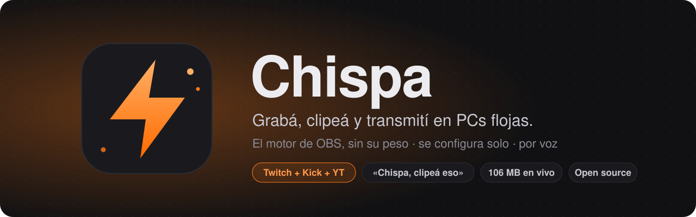
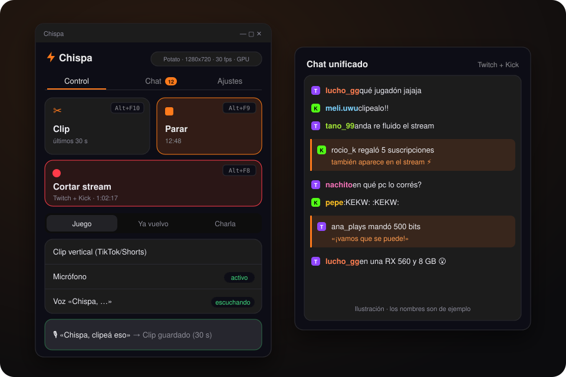
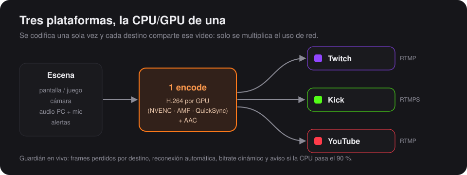
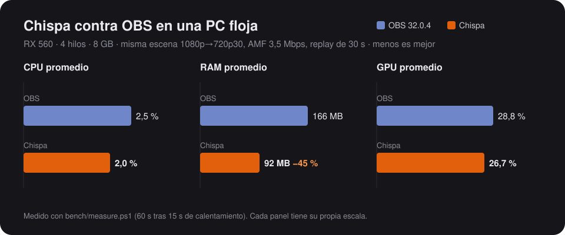

<p align="center"></p>

**Chispa** es una app para grabar, clipear y transmitir pensada para **PCs flojas**. Usa el motor de OBS (libobs) sin su interfaz pesada y se configura sola según tu PC. La manejás con botones, con atajos o con la voz: *«Chispa, clipeá eso»*.

<p align="center"></p>

## Qué hace

| | |
|---|---|
| ⚙️ **Se configura sola** | Detecta CPU, RAM, monitor y GPU. Elige el perfil **Potato / Normal / Alto** y el encoder por hardware (NVENC, AMF o QuickSync). Si no hay GPU usa x264. Si el micrófono por defecto es "Mezcla estéreo", que duplica el audio, elige un mic real. |
| ✂️ **Clips al toque** | Guarda siempre los últimos 30 s en RAM y los graba con **Alt+F10**. Con **Alt+F11** arma además la versión vertical 9:16 para TikTok, Shorts o Reels. |
| 🔴 **Multistream** | Transmite a Twitch, Kick y YouTube a la vez **codificando una sola vez**, así que mandar a tres plataformas gasta la CPU/GPU de una. |
| 🛡️ **Guardián en vivo** | Vigila los frames perdidos de cada destino, reconecta solo, usa bitrate dinámico y avisa si la CPU pasa el 90 %. |
| 🎙️ **Voz** | *«Chispa, clipeá eso»*, *«Chispa, en vivo en Kick»*, *«Chispa, ya vuelvo»*. Usa el reconocedor de Windows: sin descargas, sin internet y con muy poca CPU. |
| 💬 **Chat unificado** | Muestra el chat de Twitch y Kick en una sola lista. Las alertas de subs, regalos, raids y bits aparecen también en el stream. |
| 🔑 **Cuenta de Twitch** | Se conecta por OAuth: Chispa trae la clave sola y te deja cambiar el título y la categoría y poner marcadores. |
| 🎬 **Escenas listas** | *Juego* (pantalla con la cámara en la esquina), *Ya vuelvo* y *Charla* (cámara a pantalla completa). |
| 🪶 **Modo Stream** | Cierra la interfaz y deja Chispa en la bandeja: en vivo ocupa unos **106 MB**. |

## Multistream sin pagar doble

<p align="center"></p>

## Chispa contra OBS

<p align="center"></p>

La PC de prueba tiene una RX 560, 4 hilos y 8 GB de RAM. Las dos apps corrieron la misma escena (1080p→720p30, AMF a 3,5 Mbps, replay de 30 s, sin audio). Se midió durante 60 s, después de 15 s de calentamiento, con [`bench/measure.ps1`](bench/measure.ps1). OBS estaba minimizado en la bandeja.

| | CPU prom. | RAM prom. | RAM máx. | GPU prom. |
|---|---|---|---|---|
| OBS 32.0.4 | 2,5 % | 166 MB | 213 MB | 28,8 % |
| **Chispa** | **2,0 %** | **92 MB** | **99 MB** | **26,7 %** |

Consumo de la app completa, medido con [`bench/measure-app.ps1`](bench/measure-app.ps1) (incluye los procesos de WebView2):

| | CPU prom. | RAM total |
|---|---|---|
| Ventana abierta | 3,3 % | 450 MB |
| **Modo Stream / bandeja** | **2,8 %** | **106 MB** |

## Instalar

1. Bajá `Chispa-…-windows-x64.zip` desde [Releases](../../releases) y descomprimilo.
2. Hacé doble clic en **`Instalar Chispa.cmd`**. No pide permisos de administrador: se instala en `%LOCALAPPDATA%\Programs\Chispa` y crea accesos directos.

Para desinstalar, corré `uninstall.ps1` en esa carpeta. Tus clips en `Videos\Chispa` no se borran.

## Atajos y voz

| Atajo | Acción | Por voz (español) | Por voz (inglés) |
|---|---|---|---|
| Alt+F10 | Clip (últimos 30 s) | «Chispa, clipeá eso» | «Chispa, clip that» |
| Alt+F11 | Clip + versión vertical | «Chispa, clip vertical» | «Chispa, vertical clip» |
| Alt+F9 | Grabar / parar | «Chispa, empezá a grabar» / «pará de grabar» | «start / stop recording» |
| Alt+F8 | En vivo / cortar | «Chispa, en vivo (en Twitch · Kick · YouTube · todas)» / «cortá el stream» | «go live (on …)» / «end stream» |
| Alt+F7 | Mutear el mic | «Chispa, muteá / activá el micrófono» | «mute / unmute mic» |
| Alt+F6 | Prender / apagar la voz | — | — |
| — | Escenas | «Chispa, escena juego» · «ya vuelvo» · «escena charla» | «game scene» · «be right back» · «chat scene» |
| — | Cámara | «Chispa, prendé / apagá la cámara» | «camera on / off» |
| — | Marcador de Twitch | «Chispa, marcador» | «Chispa, marker» |

> La voz usa el reconocimiento de voz de Windows. Si no tenés el paquete de voz en español, agregalo en *Configuración → Hora e idioma → Voz*.

## Configurar las plataformas

- **Twitch.**
  - Tenés dos opciones:
    - Pegar la clave a mano.
    - Conectar la cuenta. Creá una app en [dev.twitch.tv/console](https://dev.twitch.tv/console/apps/create), de tipo *Public*, con URL de redirección `http://localhost`, y pegá su **Client ID** en *Ajustes → Twitch → Conectar cuenta*. Chispa abre twitch.tv/activate y te muestra el código para escribir ahí.
  - El chat se lee de forma anónima: alcanza con el nombre del canal.
- **YouTube.** Pegá la clave de *YouTube Studio → Emitir en vivo*.
- **Kick.**
  - Pegá la URL del servidor y la clave de tu panel (*Stream*).
  - Para el chat, poné tu canal. Si Kick bloquea la búsqueda, poné el número de chatroom: está en `kick.com/api/v2/channels/<tu canal>`, en el campo `chatroom.id`.
- **Clips verticales.** Usan ffmpeg si está instalado (`winget install Gyan.FFmpeg`) o si hay un `ffmpeg.exe` junto a `chispa.exe`.

Las claves y los tokens se guardan en el **Administrador de credenciales de Windows**, nunca en un archivo. Los ajustes van en `%APPDATA%\Chispa\config.json`.

## Compilar

Requisitos: Rust estable (MSVC) y Windows 10/11.

```powershell
cargo install cargo-obs-build --locked
cargo build --release --workspace
cargo obs-build build --out-dir target/release   # descarga el runtime de OBS 32.1.0
.\package.ps1                                     # arma dist\Chispa-<versión>-windows-x64.zip
```

- **`core/`**:
  - el motor (libobs vía [libobs-rs](https://github.com/libobs-rs/libobs-rs));
  - la autoconfiguración y el bus de comandos;
  - el multistream y el guardián;
  - los clips verticales;
  - el prototipo de consola `chispa-proto`.
- **`app/`**:
  - la app de escritorio, hecha con Tauri 2 y WebView2, sin Node ni npm;
  - la voz, el chat, OAuth de Twitch y la bandeja.
- **`installer/`**: los scripts de instalación.

Los tests se corren con `cargo test --release --workspace`. Con `CHISPA_DEBUG=1`, el prototipo de consola muestra qué micrófono eligió.

## Pendientes

- Falta probar en vivo de verdad a cada plataforma: hasta ahora se probaron el encode, el armado de las salidas y el guardián.
- Para leer el chat de YouTube hace falta OAuth de Google: por ahora solo se transmite.
- Los mensajes del motor todavía están solo en español; la interfaz está en español e inglés.

## Licencia

[GPL-3.0-or-later](LICENSE). Chispa usa libobs (GPL-2.0-or-later) y libobs-rs (GPL-3.0).
